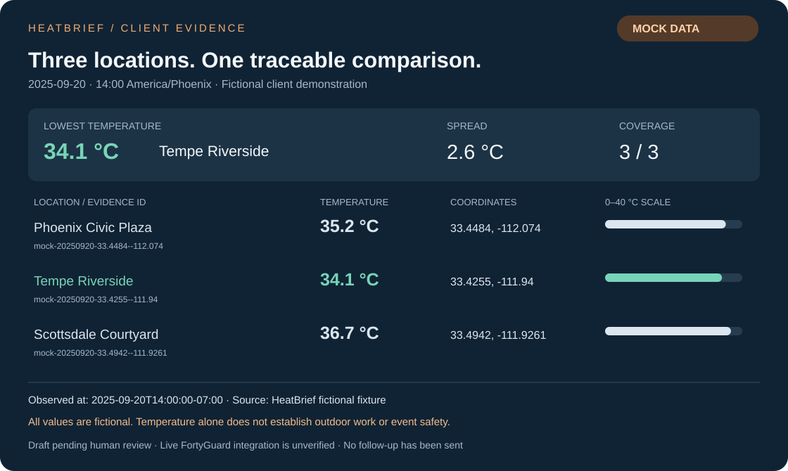

# HeatBrief

**AI Temperature Analyst + Automated Client Briefing Workflow**

Turn a business question and explicit coordinates into a reproducible temperature comparison, a traceable report, and an unsent client follow-up. Python calculates the ranking; an MCP-connected assistant can explain the evidence. An n8n webhook can trigger the same workflow through a local HTTP bridge.

**Demo status:** working mock prototype. All temperatures and client details are fictional. Live FortyGuard integration is gated until access, transport and response schemas are verified. The n8n export still needs runtime import/execution testing.



*Preview generated from the included sample briefing. [Sample report](examples/generated/demo-phoenix-001/report.md) · [Draft follow-up](examples/generated/demo-phoenix-001/follow-up.txt) · [CI runs](https://github.com/Marr-star/heatbrief-mcp-automation/actions)*

## Run the demo

Requirements: [uv](https://docs.astral.sh/uv/getting-started/installation/) and Git. Python 3.12 is pinned; uv can install it. No API key is needed in mock mode. Node.js 22+ is used for workflow checks.

```powershell
uv sync --locked
uv run heatbrief ping
uv run heatbrief compare examples/request.json
uv run heatbrief show demo-phoenix-001
```

The comparison writes `report.md`, `follow-up.txt` and `briefing.json` to `reports/demo-phoenix-001/`, with request history in `data/heatbrief.sqlite3`. Repeating the same request replays the saved result. Changed content needs a new ID.

The fixture's lowest temperature is **Tempe Riverside, 34.1 °C**, with a 2.6 °C spread. Temperature alone does not establish outdoor work or event safety. Follow-ups remain drafts for human review.

Open [`docs/demo.html`](docs/demo.html) locally to play the two-minute recorded CLI walkthrough. [Transcript](docs/assets/demo-transcript.txt) · [Recording and walkthrough notes](docs/demo-walkthrough.md).

## Two connected demonstrations

| Entry point | Flow | Setup |
|---|---|---|
| Coding assistant | `create_briefing` MCP tool → Python service → mock MCP → evidence and draft | [Agent setup](docs/agent-setup.md) |
| n8n webhook | Authenticated HTTP bridge → same Python service → SQLite → review packet | [n8n setup](docs/n8n-setup.md) |

```text
Request -> validate -> MCP measurements -> Python comparison
                                              |
                              SQLite <- report + unsent draft -> human review
```

The automation uses an HTTP Request node to reach the tested local bridge; it does not claim a native FortyGuard MCP connection from n8n. A separate reviewer token records approval or rejection. Approval marks a draft for manual sending; the project contains no email-sending transport.

Start the local API after replacing both token placeholders in `.env`:

```powershell
Copy-Item .env.example .env
.\scripts\run-api.ps1
```

API docs: `http://127.0.0.1:8000/docs`. Fixture coverage is limited to the three example points at 2025-09-20, 14:00 America/Phoenix. This mock does not generate weather for arbitrary dates or locations.

## Verification

```powershell
uv run pytest -q
uv run ruff check .
uv run ruff format --check .
node scripts/check-workflow.cjs
node scripts/check-demo.cjs
```

The test suite covers real MCP stdio round trips, timezones/DST, provenance and units, missing evidence, bounded retries, concurrent duplicates, persistent replay, API authentication and human review. A real local HTTP smoke test passed. GitHub CI runs the Python suite and workflow checks on Windows and Ubuntu.

See [test evidence and limits](docs/testing-report.md), [MCP feedback](mcp-feedback.md), [troubleshooting](docs/troubleshooting.md), [example prompts](examples/prompts.md) and [build phases](docs/plan.md).

Live coverage, provider errors and rate limits have **not** been observed. The recording shows actual CLI commands against the mock; a coding-assistant UI session and n8n execution remain unverified. [Integration boundary and live checklist](docs/integration.md).
