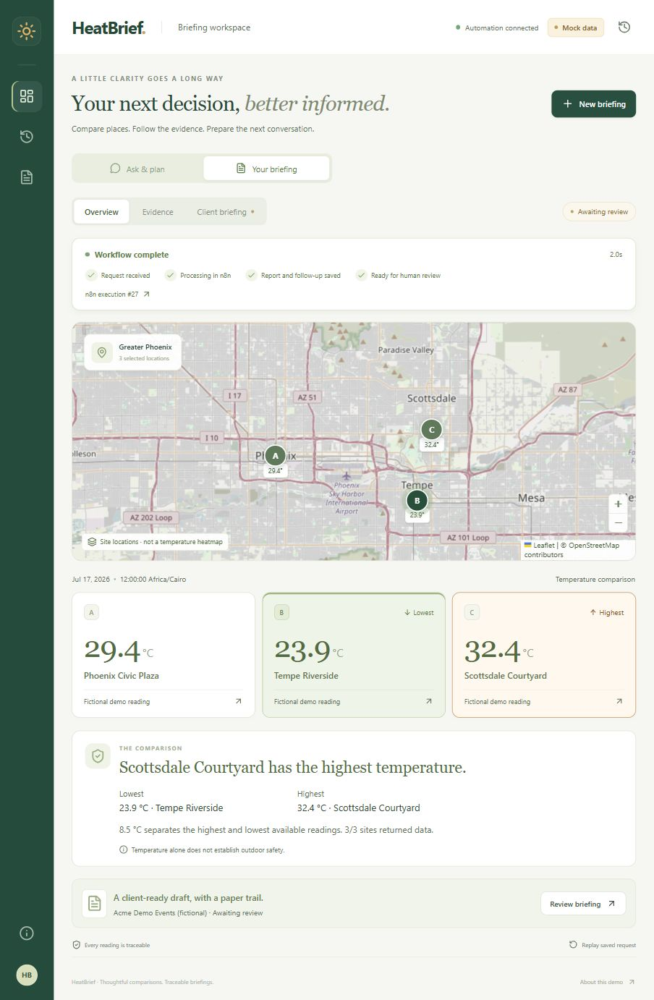

# HeatBrief

**AI Temperature Analyst + Automated Client Briefing Workflow**

Turn a business question and explicit coordinates into a reproducible temperature comparison, a traceable report, and an unsent client follow-up. Python calculates the ranking; an MCP-connected assistant can explain the evidence. An n8n webhook can trigger the same workflow through a local HTTP bridge.

**Demo status:** working mock prototype, including a verified local n8n automation. All temperatures and client details are fictional. Live FortyGuard integration is gated until access, transport and response schemas are verified.

## Open the briefing workspace

```powershell
uv sync --locked
uv run python scripts/start-workspace.py
```

Open **http://127.0.0.1:8001**. In VS Code you can use **Terminal → Run Task → HeatBrief: open web workspace**.

The website runs complete comparison commands directly from chat, asks for missing details conversationally, and answers highest/lowest, average, ranking and terminology questions from saved evidence. It includes a location map, both-extremes comparison cards, real n8n tracking, saved briefings, editable follow-ups, review and PDF/Markdown downloads. It runs locally with your existing automation. Guided mode works without a model key; optional AI intake is documented in [the workspace guide](docs/web-workspace.md).



*Local workspace after a real n8n execution using fictional demo temperatures. [Sample report](examples/generated/demo-phoenix-001/report.md) · [Draft follow-up](examples/generated/demo-phoenix-001/follow-up.txt) · [CI runs](https://github.com/Marr-star/heatbrief-mcp-automation/actions)*

## Run the demo

Requirements: [uv](https://docs.astral.sh/uv/getting-started/installation/) and Git. Python 3.12 is pinned; uv can install it. No API key is needed in mock mode. Node.js 22+ is used for workflow checks.

```powershell
uv sync --locked
uv run heatbrief ping
uv run heatbrief compare examples/request.json
uv run heatbrief show demo-phoenix-001
```

The comparison writes `report.md`, `follow-up.txt` and `briefing.json` to `reports/demo-phoenix-001/`, with request history in `data/heatbrief.sqlite3`. Repeating the same request replays the saved result. Changed content needs a new ID.

The original fixture's lowest temperature is **Tempe Riverside, 34.1 °C**; the highest is **Scottsdale Courtyard, 36.7 °C**, with a 2.6 °C spread. Temperature alone does not establish outdoor work or event safety. Follow-ups remain drafts for human review.

Open [`docs/demo.html`](docs/demo.html) locally to play the two-minute recorded CLI walkthrough. [Transcript](docs/assets/demo-transcript.txt) · [Recording and walkthrough notes](docs/demo-walkthrough.md).

## Two connected demonstrations

To test the actual automation in VS Code, choose **Terminal → Run Task → HeatBrief: start automation**, then **HeatBrief: test automation**. This runs an isolated local n8n instance and sends real webhook requests through it. Requires Node.js 24+. [Local automation guide](docs/local-automation.md) · [Runtime test evidence](docs/automation-test-report.md).

| Entry point | Flow | Setup |
|---|---|---|
| Coding assistant | `create_briefing` MCP tool → Python service → mock MCP → evidence and draft | [Agent setup](docs/agent-setup.md) |
| n8n webhook | Authenticated HTTP bridge → same Python service → SQLite → review packet | [n8n setup](docs/n8n-setup.md) |

```text
Request -> validate -> MCP measurements -> Python comparison
                                              |
                              SQLite <- report + unsent draft -> human review
```

The automation uses an HTTP Request node to reach the tested local bridge; it does not claim a native FortyGuard MCP connection from n8n. A separate reviewer token records approval or rejection. Approval marks a draft for manual sending; the project contains no email-sending transport.

Start the local API after replacing both token placeholders in `.env`:

```powershell
if (!(Test-Path .env)) { Copy-Item .env.example .env }
.\scripts\run-api.ps1
```

API docs: `http://127.0.0.1:8000/docs`. The three demo sites support **2025-01-01 00:00 through 2027-12-31 23:59 America/Phoenix, inclusive**, at any minute: 1,095 dates and 1,576,800 time slots per site. The original sample keeps its fixed values; all other readings are reproducible synthetic scenarios with date/time-specific evidence IDs. They are not observed weather or forecasts. Other locations and instants outside this window remain unsupported.

## Verification

```powershell
uv run pytest -q
uv run ruff check .
uv run ruff format --check .
node scripts/check-workflow.cjs
node scripts/check-demo.cjs
```

The test suite covers real MCP stdio round trips, timezones/DST, provenance and units, missing evidence, bounded retries, concurrent duplicates, persistent replay, API authentication, browser sessions/CSRF, intake, workspace run tracking, draft edits, PDF content and human review. A real local HTTP smoke test passed. GitHub CI runs Python checks on Windows and Ubuntu and builds the React frontend.

See [test evidence and limits](docs/testing-report.md), [MCP feedback](mcp-feedback.md), [troubleshooting](docs/troubleshooting.md), [example prompts](examples/prompts.md) and [build phases](docs/plan.md).

Live coverage, provider errors and rate limits have **not** been observed. The recording shows actual CLI commands against the mock. The n8n workflow has since passed a real local execution test; a coding-assistant UI session remains unverified. [Integration boundary and live checklist](docs/integration.md).
